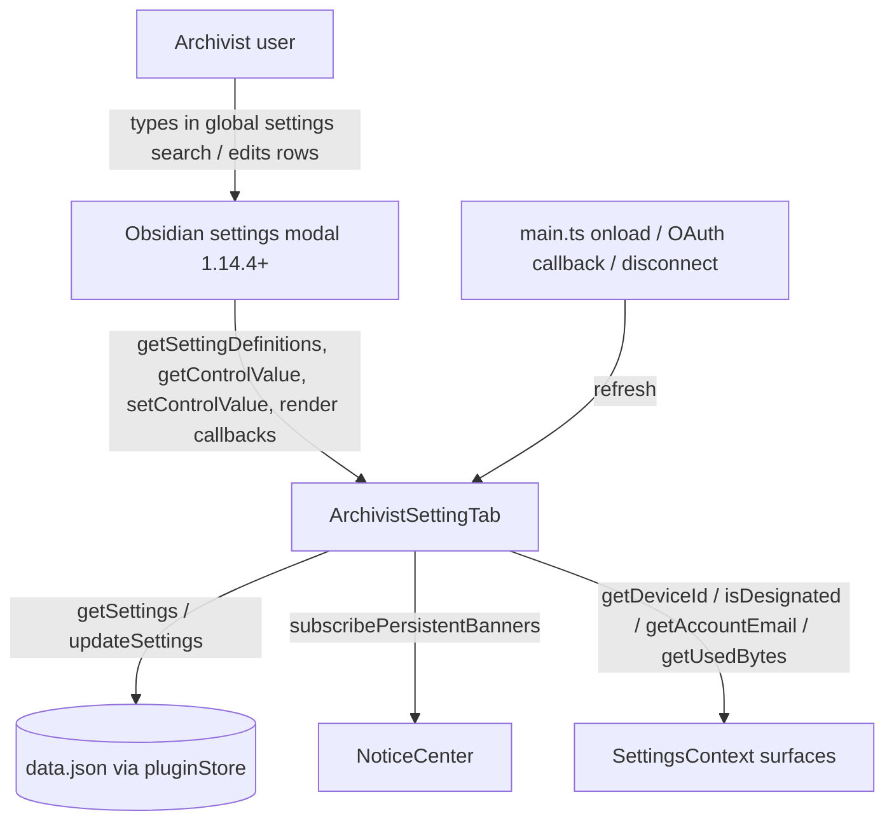

# Solution Design Document

## Validation Checklist

### CRITICAL GATES (Must Pass)

- [x] All required sections are complete
- [x] No [NEEDS CLARIFICATION] markers remain
- [x] Architecture pattern is clearly stated with rationale
- [x] **All architecture decisions confirmed by user**
- [x] Every interface has specification

### QUALITY CHECKS (Should Pass)

- [x] All context sources are listed with relevance ratings
- [x] Project commands are discovered from actual project files
- [x] Constraints → Strategy → Design → Implementation path is logical
- [x] Every component in diagram has directory mapping
- [x] Error handling covers all error types
- [x] Quality requirements are specific and measurable
- [x] Component names consistent across diagrams
- [x] A developer could implement from this design
- [x] Implementation examples use actual schema column names (not pseudocode), verified against migration files — _N/A: no database; examples use the real `PluginSettings` field paths from `src/model/Settings.ts`_
- [x] Complex queries include traced walkthroughs with example data showing how the logic evaluates — _the refresh loop guard is traced in Complex Logic_

---

## Constraints

CON-1 **Platform.** Obsidian desktop plugin in TypeScript 6.0.3, bundled with esbuild.
- `minAppVersion` is raised to **1.14.4** and the `obsidian` types are pinned to **1.14.4** exactly, so the types match the runtime minimum.
- Desktop only (`isDesktopOnly`).
- The CSS target stays at browserslist `chrome 139` (ADR-6).

CON-2 **Code standards.**
- Lint mirrors the Obsidian review bot: `typescript-eslint` `recommendedTypeChecked`, plus `eslint-plugin-obsidianmd` **0.6.0** `recommended`, plus the local `no-unsafe-innerhtml` rule. It must pass with zero errors.
- No `innerHTML`. The only DOM is the `Setting` rows Obsidian hands to `render` callbacks.
- A file-level "why" comment on every new file (MiYo Constitution, Code Quality L2).
- Files stay at or under ~300–500 lines of dense logic.

CON-3 **Privacy.**
- No telemetry and no new network calls (Constitution, Privacy & Security L1).
- Settings stay in `data.json` at today's paths. Credentials stay in `app.secretStorage` and are not touched by this change.

CON-4 **Process.**
- One feature branch (`feat/54-declarative-settings`) and one PR.
- Out-of-scope defects stay in issues #109–#113.
- Local `main` is one commit behind `origin/main` (release commit `b45ffd6`, 0.11.7). Rebase onto `origin/main` before the PR.

## Implementation Context

### Required Context Sources

#### Documentation Context
```yaml
- doc: docs/XDD/specs/002-declarative-settings/requirements.md
  relevance: CRITICAL
  why: "Approved PRD — features F1–F8 and their acceptance criteria"

- doc: docs/XDD/specs/002-declarative-settings/README.md
  relevance: HIGH
  why: "Decisions log (minAppVersion 1.14.4, scope cuts, issue numbers) and research summary"

- url: https://docs.obsidian.md/Plugins/User+interface/Settings
  relevance: CRITICAL
  why: "Declarative settings API: control / render / action rows, groups, visible, aliases, update(), dot-notation keys (section 'Advanced: nested settings with dot-notation keys')"

- url: https://docs.obsidian.md/Plugins/Guides/Migrate+to+declarative+settings
  relevance: HIGH
  why: "Migration checklist and pitfalls ('calling display() won't refresh anything declarative')"

- doc: https://github.com/obsidianmd/eslint-plugin (docs/rules/settings-tab/*.md, docs/configuration.md 'Upgrading to 0.6.0')
  relevance: HIGH
  why: "prefer-setting-definitions / no-deprecated-display / prefer-update-over-display; 0.5/0.6 breaking changes"
```

#### Code Context
```yaml
- file: src/ui/SettingsTab.ts
  relevance: CRITICAL
  why: "Current tab (464 LOC): display(), refresh paths, ObsidianSectionHost — rewritten"

- file: src/ui/settings/SectionHost.ts
  relevance: CRITICAL
  why: "FieldSpec union + SectionHost interface — extended with key / visible / aliases"

- file: src/ui/settings/sections/BackupSchedule.ts
  relevance: HIGH
  why: "Conditional active-window pickers (F7), designated-device toggle (non-settings side effect)"
- file: src/ui/settings/sections/Retention.ts
  relevance: HIGH
  why: "Section-level STORAGE banner, retention estimate static row"
- file: src/ui/settings/sections/Notifications.ts
  relevance: MEDIUM
  why: "Four plain toggles — the simplest mapping case"
- file: src/ui/settings/sections/Advanced.ts
  relevance: HIGH
  why: "Textarea globs (silent rejection), vault_prefix (fresh-read, past typing-wipe bug), sliders (emitted as kind:'slider' at Advanced.ts:121,133; the deprecated setDynamicTooltip call lives in SettingsTab.ts:460 renderSlider)"
- file: src/ui/settings/sections/Dropbox.ts
  relevance: HIGH
  why: "Connected / disconnected branches, actionRow with the Disconnect warning → setDestructive"

- file: src/ui/settings/context.ts
  relevance: HIGH
  why: "SettingsContext: getSettings / updateSettings / cached async fields"

- file: src/main.ts
  relevance: HIGH
  why: "Tab construction (1258-1263), pre-fill of async fields (1240-1256), refresh() callers (194, 1220, 1277)"

- file: src/ui/NoticeCenter.ts
  relevance: HIGH
  why: "subscribePersistentBanners(handler) → unsubscribe fn (207-212); getPersistentBanners"

- file: tests/fixtures/obsidian-mock.ts
  relevance: HIGH
  why: "Inert PluginSettingTab/Setting stubs (481-529) — needs 1.13+ SettingTab members, ButtonComponent.setDestructive, debounce"

- file: tests/fixtures/recording-section-host.ts
  relevance: HIGH
  why: "Test host for section renderers — must honour the new `visible` field"

- file: tests/ui/settings-*.test.ts
  relevance: HIGH
  why: "Five suites asserting section output; settings-tab.test.ts asserts heading order + persistentToBannerSpec"

- file: eslint.config.mjs
  relevance: HIGH
  why: "Flat config; needs `files` scoping for obsidianmd 0.6.0 (manifest/LICENSE linting)"

- file: manifest.json, versions.json, version-bump.mjs
  relevance: MEDIUM
  why: "minAppVersion source; version-bump.mjs copies manifest.minAppVersion into versions.json at release"

- file: package.json
  relevance: MEDIUM
  why: "obsidian 1.12.3 → 1.14.4, eslint-plugin-obsidianmd 0.4.2 → 0.6.0, browserslist"

- file: docs/installation.md, docs/troubleshooting.md, README.md
  relevance: MEDIUM
  why: "State the minimum Obsidian version (1.11.4 today) — F5"
```

#### External APIs
```yaml
- service: Obsidian Plugin API 1.14.4 (settings)
  doc: obsidian.d.ts 1.14.4 (SettingTab, PluginSettingTab, SettingDefinition*, ButtonComponent)
  relevance: CRITICAL
  why: "The contract this design implements. No network involvement."
```

### Implementation Boundaries

- **Must Preserve:**
  - Every `PluginSettings` path and value encoding, so `data.json` stays compatible.
  - Section order, row labels, descriptions, options and bounds.
  - Validation outcomes:
    - HH:MM and vault_prefix fields show an inline error and are not saved;
    - numbers and globs are rejected silently.
  - Designated-device toggle side effects.
  - Banner severity mapping (`persistentToBannerSpec`).
  - The public `ArchivistSettingTab.refresh()` signature used by `main.ts`.
  - The pre-fill of `deviceId` and `dropboxAccountEmail` in `main.ts`.
- **Can Modify:**
  - `SettingsTab.ts` (full rewrite).
  - `SectionHost.ts` (additive fields).
  - Section renderers: add `key`, `visible` and `aliases`, and emit conditional rows unconditionally.
  - The test fixtures, `eslint.config.mjs`, `package.json`, `manifest.json` and the docs.
- **Must Not Touch:**
  - `PluginSettings` model and the settings migration code.
  - `NoticeCenter` behaviour.
  - The token store / `secretStorage`.
  - `version-bump.mjs`, which already does the right thing.
  - The confirm stub (#109), the onChange snapshot logic beyond what ADR-2 implies (#110), silent rejection (#111), deviceId display (#112).

### External Interfaces

#### System Context Diagram



#### Interface Specifications

```yaml
inbound:
  - name: "Obsidian SettingTab contract (1.14.4)"
    type: In-process method calls
    format: TypeScript (obsidian.d.ts)
    authentication: n/a
    data_flow: "Obsidian calls getSettingDefinitions() on addSettingTab and on update(); getControlValue(key) per control render; setControlValue(key, value) per user change; render(setting, group) per custom row render; hide() on tab leave"

  - name: "ArchivistSettingTab.refresh()"
    type: In-process async call
    format: "refresh(): Promise<void>"
    authentication: n/a
    data_flow: "main.ts signals backing state changed (OAuth done, disconnect, email backfill)"

outbound:
  - name: "SettingsContext"
    type: In-process
    format: "src/ui/settings/context.ts"
    data_flow: "Settings read/write; async device + Dropbox lookups (local token store; usage stub)"
    criticality: HIGH

  - name: "NoticeCenter persistent banners"
    type: In-process pub/sub
    format: "subscribePersistentBanners(cb) → unsubscribe; getPersistentBanners()"
    data_flow: "Banner set changes"
    criticality: MEDIUM

data:
  - name: "Plugin settings (data.json)"
    type: Obsidian plugin data file
    connection: ctx.updateSettings → pluginStore.saveSettings
    data_flow: "Unchanged paths and encodings"
```

### Cross-Component Boundaries

- **API Contracts:**
  - `PluginSettings` (the `data.json` shape) must not change.
  - `ArchivistSettingTab.refresh()` must not change.
  - `persistentToBannerSpec` stays exported, because it is tested.
- **Team Ownership:** the sole maintainer. No other MiYo repo consumes the settings tab.
- **Shared Resources:**
  - The NoticeCenter banner feed is also consumed by `BackupBrowserView` and the ribbon/status wiring. Subscribing is read-only.
- **Breaking Change Policy:**
  - Raising `minAppVersion` is the only breaking change. It is user-facing and goes in the changelog (F5).
  - Kado, Hashi and Hakobi are informed by an optional `_outbox/` handoff (PRD, Could Have).

### Project Commands

```bash
# Discovered from package.json
Install:   npm install            # run OUTSIDE the sandbox (npm cache ~/.npm is outside the write set; see memory note)
Dev:       npm run dev            # esbuild watch
Test:      npm test               # vitest run
Lint:      npm run lint           # eslint src/ && stylelint styles.css
Typecheck: npm run typecheck      # tsc --noEmit
Build:     npm run build          # tsc --noEmit && esbuild production build
Audit:     npm run audit
Scorecard: /obsidian-eval         # after the release is re-scanned
```

## Solution Strategy

- **Architecture pattern: an adapter (translator) over the existing section-renderer abstraction.**
  - Section renderers stay pure functions `(host: SectionHost, ctx: SettingsContext) => void` that emit `FieldSpec`s.
  - A new `DefinitionBuilderHost` implements `SectionHost` and collects those specs into Obsidian `SettingDefinitionItem[]`.
  - `ArchivistSettingTab` becomes a thin declarative tab: it builds definitions, routes `setControlValue` back to the emitting spec, and runs refreshes through `update()`.
- **Integration approach.**
  - `display()`, `ObsidianSectionHost`, the `hide()` override and every `this.display()` call are deleted.
  - Refresh is event-driven: the banner subscription, the open-time async fetch, and `refresh()` each end in a debounced `update()`. Obsidian keeps a focused control row intact across `update()` (verified in the 1.14.4 runtime), which covers the typing-wipe risk without extra code.
- **Justification.**
  - The `FieldSpec` layer already makes the sections data-shaped and testable without Obsidian (Constitution, Code Quality L1). Reusing it gives one source of truth and keeps the five section test suites meaningful.
  - The translator is the single place where Obsidian's declarative types appear.
- **Key decisions:** ADR-1 to ADR-6 below.

## Building Block View

### Components

```mermaid
graph LR
    Obsidian[Obsidian settings modal] --> Tab[ArchivistSettingTab]
    Tab -->|runs sections against| Builder[DefinitionBuilderHost]
    Sections[Section renderers x5] -->|emit FieldSpec| Builder
    Builder -->|SettingDefinitionItem[] + key→spec registry| Tab
    Builder -->|render callbacks| RowRenderers[CustomRowRenderers]
    Tab --> Ctx[SettingsContext]
    Tab --> NC[NoticeCenter]
    Sections --> Ctx
```

| Component | Single responsibility | PRD features owned |
|---|---|---|
| **Section renderers** (`sections/*.ts`, modified) | Describe *what* each section shows: labels, values, bounds, validation, `key`, `visible`, `aliases`, onChange semantics | F2 (row content parity), F7 (visible predicates), F8 (alias lists) |
| **FieldSpec model** (`SectionHost.ts`, modified) | The shared row-description vocabulary between sections and hosts | (contract, no behaviour) |
| **DefinitionBuilderHost** (`DefinitionBuilderHost.ts`, new) | Translate the `FieldSpec` stream into Obsidian groups and definitions: input kinds become `control` rows, everything else becomes a `render` row. Hold the key → spec registry and enforce today's accept/reject rules on writes | F1 (every inventory row becomes an indexed definition), F2 (validation parity), F4 (destructive mapping) |
| **CustomRowRenderers** (`customRows.ts`, new) | Draw the non-input rows inside the `Setting` Obsidian supplies: version header, banner, static text, link, action row | F2 (header, banners, static content), F4 (`setDestructive`) |
| **ArchivistSettingTab** (`SettingsTab.ts`, rewritten) | The Obsidian contract: `getSettingDefinitions` / `getControlValue` / `setControlValue`, refresh orchestration (banner subscription, async fetch, `refresh()`, debounced `update()`) | F1 (registration and search indexing), F3 (live refresh) |
| **Tooling and release metadata** (`package.json`, `manifest.json`, `eslint.config.mjs`, test mock) | Build/lint/test against 1.14.4; declare the version floor | F5 (except the docs), F6 |
| **User docs** (`README.md`, `docs/installation.md`, `docs/troubleshooting.md`, `CHANGELOG` via the release) | State the new minimum Obsidian version and what users on older versions get | F5 (docs and changelog criteria) |

### Directory Map

**Component**: settings UI
```
.
├── src/
│   ├── ui/
│   │   ├── SettingsTab.ts                     # MODIFY (rewrite): declarative ArchivistSettingTab; ObsidianSectionHost + display() removed; persistentToBannerSpec kept
│   │   ├── strings.ts                         # MODIFY: alias lists per setting (F8) as S.ALIASES_* constants
│   │   └── settings/
│   │       ├── SectionHost.ts                 # MODIFY: add key / visible / aliases to FieldSpec kinds; drop ActionRow `warning` → `destructive`
│   │       ├── DefinitionBuilderHost.ts       # NEW: FieldSpec → SettingDefinitionItem[] + key registry + write guard
│   │       ├── customRows.ts                  # NEW: render callbacks for header / banner / static / link / actionRow
│   │       ├── context.ts                     # UNCHANGED
│   │       └── sections/
│   │           ├── BackupSchedule.ts          # MODIFY: keys; active-window rows always emitted with visible predicate; aliases
│   │           ├── Retention.ts               # MODIFY: keys; aliases
│   │           ├── Notifications.ts           # MODIFY: keys; aliases
│   │           ├── Advanced.ts                # MODIFY: keys; aliases
│   │           └── Dropbox.ts                 # MODIFY: actionRow `destructive: true`; aliases on Account row
│   └── main.ts                                # MODIFY (small): pass plugin.register-compatible teardown for the banner subscription (constructor dep), nothing else
├── tests/
│   ├── fixtures/
│   │   ├── obsidian-mock.ts                   # MODIFY: SettingTab 1.13+ members, ButtonComponent.setDestructive, debounce
│   │   ├── recording-section-host.ts          # MODIFY: record visible/aliases/key; `findField` skips invisible by default
│   │   ├── obsidian-mock.test.ts              # NEW: fixture self-test for the 1.13+ SettingTab surface
│   │   └── settings-0.11.x.data.json          # NEW: captured 0.11.x settings with non-default values
│   └── ui/
│       ├── settings-definition-builder.test.ts  # NEW: mapping, grouping, write guard, validation mapping
│       ├── settings-custom-rows.test.ts       # NEW: header / banner / static / link / actionRow renderers
│       ├── settings-tab.integration.test.ts   # NEW: whole tab from a 0.11.x data.json fixture
│       ├── release-metadata.test.ts           # NEW: minAppVersion 1.14.4 + versions.json snapshot unchanged
│       ├── settings-tab.test.ts               # MODIFY: definitions shape, refresh orchestration, banner → update
│       ├── settings-backup-schedule.test.ts   # MODIFY: active-window assertions via visible predicate
│       └── settings-*.test.ts                 # MODIFY only where `warning` → `destructive` or keys are asserted
├── manifest.json                              # MODIFY: minAppVersion 1.14.4
├── package.json                               # MODIFY: obsidian 1.14.4 (exact), eslint-plugin-obsidianmd 0.6.0 (exact)
├── eslint.config.mjs                          # MODIFY: files-scope TS/type-checked blocks (obsidianmd 0.6.0 lints manifest.json / LICENSE)
├── vitest.config.ts                           # MODIFY: drop the tests/fixtures/** exclude so the mock self-test is collected (added at Phase 1 checkpoint)
├── styles.css                                 # MODIFY: retarget `.archivist-settings h2` rules (39-55) to group headings
├── evolution/2026-11/                         # NEW: toolchain entry (obsidian 1.14.4, obsidianmd 0.6.0, unsandboxed install, eslint files scoping)
├── README.md, docs/installation.md, docs/troubleshooting.md   # MODIFY: minimum Obsidian 1.14.4
```

### Interface Specifications

#### Interface Documentation References

```yaml
interfaces:
  - name: "Obsidian declarative settings"
    doc: obsidian.d.ts 1.14.4 — SettingTab / PluginSettingTab / SettingDefinitionItem / SettingControl / SettingDefinitionRender
    relevance: CRITICAL
    sections: [getSettingDefinitions, update, getControlValue, setControlValue, render, visible, aliases, searchable]
    why: "The contract implemented by ArchivistSettingTab + DefinitionBuilderHost"
  - name: "SectionHost / FieldSpec"
    doc: src/ui/settings/SectionHost.ts
    relevance: HIGH
    sections: [FieldSpec union, SectionHost]
    why: "Extended additively; both hosts (builder, recording) implement it"
```

#### Data Storage Changes

No storage changes. `data.json` paths and encodings stay byte-compatible. Example: `schedule.full_day_of_week` is still a number, and `advanced.exclusion_globs` is still a `string[]`.

#### Internal API Changes

No HTTP endpoints. The changed in-process interfaces are:

```yaml
FieldSpec additions (SectionHost.ts):
  Input kinds (text | toggle | number | dropdown | textarea | slider):
    + key: string            # REQUIRED. Dotted PluginSettings path, e.g. 'schedule.full_cadence'.
                             #   Unique within its section. Non-settings rows use a reserved
                             #   prefix 'ui.' (e.g. 'ui.device_designated').
  All kinds:
    + visible?: () => boolean   # Evaluated by Obsidian each render (F7). Absent = always visible.
    + aliases?: string[]        # Extra search terms (F8). Only meaningful on searchable rows.
  ActionRowFieldSpec.actions[]:
    ~ warning?: boolean  →  destructive?: boolean   # Maps to ButtonComponent.setDestructive() (F4)
  StaticTextSpec / BannerSpec / LinkFieldSpec:
    (no new required fields — the builder derives stable internal row names)

DefinitionBuilderHost (NEW):
  constructor(renderers: CustomRowRenderers)   # interface type declared in SectionHost.ts (T2.1) so builder and renderers can be built in parallel
  heading(text): void                 # opens a new group { type: 'group', heading: text, items: [] }
  topBanner(spec): void               # appends a render row to the top group (no heading)
  field(spec): void                   # appends one definition to the current group
  header(info): void                  # appends the version header render row to the top group (first item)
  result(): { items: SettingDefinitionItem[]; registry: Map<string, InputFieldSpec> }
  # Throws in dev/test if two input specs in the same group share a key (Obsidian keys rows by ctrl:<key>).

ArchivistSettingTab (REWRITTEN):
  constructor(app, deps: { plugin, noticeCenter, context, register: (teardown: () => void) => void })
  getSettingDefinitions(): SettingDefinitionItem[]   # sync; runs the 5 sections + top group through a fresh builder
  getControlValue(key): unknown                      # registry.get(key)?.value
  setControlValue(key, value): Promise<void>         # write guard → spec.onChange(coerced) → scheduleUpdate()
  refresh(): Promise<void>                           # unchanged signature; forces update() after async fetch
  (private) refreshAsyncFields(force): Promise<void> # guard + diff, then scheduleUpdate() on change/force
  (private) scheduleUpdate: () => void               # debounce(() => this.update(), 150, false) — resetTimer=false: fires 150 ms after the FIRST call of a burst; later calls in the window coalesce
  # Removed: display(), hide() override, ObsidianSectionHost, renderHeader(), subscribeBannerUpdates().
```

#### Application Data Models

```pseudocode
ENTITY: FieldSpec (MODIFIED) — see Internal API Changes

ENTITY: DefinitionBuildResult (NEW, transient — rebuilt on every getSettingDefinitions())
  FIELDS:
    items: SettingDefinitionItem[]
      [0] group (no heading): header render row, then one render row per persistent banner
      [1..5] group per section heading, in emitted order (Schedule, Retention, Notifications, Advanced, Dropbox account)
    registry: Map<key, InputFieldSpec>   # the specs from THIS build; replaced on the next build

ENTITY: Mapping table FieldSpec.kind → definition
  text      → control { type:'text', key, placeholder, validate: v => spec.validate?.(v) ?? undefined }
  toggle    → control { type:'toggle', key }
  number    → control { type:'number', key, min, max, step }                  # write guard enforces silent reject
  dropdown  → control { type:'dropdown', key, options: Object.fromEntries(spec.options.map(o => [o.value, o.label])) }
  textarea  → control { type:'textarea', key }                                # write guard enforces silent reject
  slider    → control { type:'slider', key, min, max, step }                  # value shown inline (no tooltip API)
  actionRow → render  (customRows.actionRow)    searchable, name=label, desc=description
  link      → render  (customRows.link)         searchable, name=label
  static    → render  (customRows.static)       searchable:false, internal name 'static:<section>:<n>'
  banner    → render  (customRows.banner)       searchable:false, internal name 'banner:<code>'
  header    → render  (customRows.header)       searchable:false, internal name 'header'
  readonly / button → throws 'unsupported (#112)' — no renderer exists and neither kind is emitted; fail loud instead of drawing an empty row (amended 2026-11-21, Phase 2 checkpoint)
  Every definition: name=label, desc=description, aliases, visible copied from the spec.
```

#### Integration Points

```yaml
- from: ArchivistSettingTab
  to: NoticeCenter
    - protocol: in-process subscription
    - endpoints: subscribePersistentBanners (constructor), getPersistentBanners (each build)
    - data_flow: "Banner set change → scheduleUpdate(). Unsubscribed via deps.register (plugin unload)."

- from: main.ts
  to: ArchivistSettingTab
    - protocol: in-process call
    - endpoints: refresh() at main.ts:194 (OAuth callback), :1220 (disconnect), :1277 (email backfill)
    - data_flow: "Backing state changed → async fetch + forced update()"

- from: Obsidian
  to: ArchivistSettingTab
    - protocol: SettingTab contract
    - data_flow: "Definitions at addSettingTab + every update(); control get/set; render callbacks; renderTab on every open"
```

### Implementation Examples

#### Example: write guard and dispatch in `setControlValue`

**Why this example**: this is where today's accept/reject rules, now spread across `ObsidianSectionHost.render*`, are preserved exactly (F2), and where saving meets refreshing.

```typescript
// Illustrative — mirrors SettingsTab.ts:385-386 (textarea) and :405-428 (number) semantics.
async setControlValue(key: string, value: unknown): Promise<void> {
  const spec = this.registry.get(key);
  if (!spec) return;                                   // stale key after a rebuild: ignore
  switch (spec.kind) {
    case 'number': {
      const n = typeof value === 'number' ? value : Number(value);
      if (Number.isNaN(n)) return;                     // silent reject (parity, #111 out of scope)
      if (spec.min !== undefined && n < spec.min) return;
      if (spec.max !== undefined && n > spec.max) return;
      if (spec.validate?.(n)) return;
      spec.onChange(n); break;
    }
    case 'textarea':
      if (spec.validate?.(String(value))) return;      // silent reject (parity)
      spec.onChange(String(value)); break;
    case 'text':
      // Obsidian already ran control.validate and refused to call us on an error string.
      spec.onChange(String(value)); break;
    default:
      (spec.onChange as (v: unknown) => void)(value);
  }
  this.scheduleUpdate();                               // next build snapshots fresh settings
}
```

#### Example: active window rows (F7)

**Why this example**: a conditional row becomes an always-emitted row with a predicate, so it is in the definition set but hidden from view and search while it's off.

```typescript
// BackupSchedule.ts (illustrative)
const windowOn = (): boolean => ctx.getSettings().schedule.active_window_enabled;
host.field({ kind: 'text', key: 'schedule.active_window_start', label: 'Active window start', // literal today (BackupSchedule.ts:156)
             value: settings.schedule.active_window_start, placeholder: 'HH:MM',
             validate: (v) => (HHMM_REGEX.test(v) ? null : 'Expected HH:MM (24-hour).'), // inline HHMM_REGEX + message exactly as today (BackupSchedule.ts:164)
             visible: windowOn,
             onChange: (v) => void ctx.updateSettings({ schedule: { ...ctx.getSettings().schedule, active_window_start: v } }) });
// Obsidian re-evaluates `visible` after every control change (refreshDomState), so flipping
// "Active backup window" shows/hides both rows immediately; scheduleUpdate() then refreshes search.
```

Note: the example reads `ctx.getSettings()` fresh in `onChange`. That is the pattern **only for rows this spec touches anyway** (the active-window rows, which F7 restructures). The other sections keep their current `onChange` bodies (#110 boundary). The debounced `update()` after every write narrows the stale-snapshot window from "until reopen" to about 150 ms. That reduces #110 but does not close it.

#### Test Examples as Interface Documentation

```typescript
describe('DefinitionBuilderHost', () => {
  it('maps a number spec to a control row and silently rejects out-of-range writes', async () => {
    const onChange = vi.fn();
    const tab = makeTab({ sections: [(h) => { h.heading('Retention');
      h.field({ kind: 'number', key: 'retention.daily_days', label: 'Daily retention (days)',
                value: 30, min: 0, max: 90, onChange }); }] });
    const [, retention] = tab.getSettingDefinitions() as SettingDefinitionGroup[];
    expect(retention.heading).toBe('Retention');
    expect(retention.items?.[0]).toMatchObject({ name: 'Daily retention (days)',
      control: { type: 'number', key: 'retention.daily_days', min: 0, max: 90 } });
    await tab.setControlValue('retention.daily_days', 120);
    expect(onChange).not.toHaveBeenCalled();
    await tab.setControlValue('retention.daily_days', 45);
    expect(onChange).toHaveBeenCalledWith(45);
  });
});
```

## Runtime View

### Primary Flow

#### Primary Flow: user finds and changes a setting through search (F1)
1. On plugin load, `addSettingTab` calls `getSettingDefinitions()`. Obsidian indexes every searchable definition (`name`, `desc`, `aliases`).
2. The user types "backup window" in settings search. Obsidian matches "Active backup window" and the user selects it.
3. Obsidian opens Archivist's tab and calls `renderTab()`:
   - control rows call `getControlValue(key)`;
   - the header render row runs and starts `refreshAsyncFields(false)`.
4. The user flips the toggle. Obsidian calls `setControlValue('schedule.active_window_enabled', true)`: the write guard passes, `spec.onChange` saves through `ctx.updateSettings`, then `scheduleUpdate()` runs.
5. Obsidian runs `refreshDomState()`, so the window start/end rows become visible (F7). About 150 ms later, `update()` rebuilds the definitions and the search index. Focused control rows are kept.

```mermaid
sequenceDiagram
    actor User
    participant Obs as Obsidian settings
    participant Tab as ArchivistSettingTab
    participant B as DefinitionBuilderHost
    participant Ctx as SettingsContext
    Obs->>Tab: getSettingDefinitions() (addSettingTab)
    Tab->>B: run header + banners + 5 sections
    B-->>Tab: items + registry
    User->>Obs: search "backup window", select result
    Obs->>Tab: renderTab → getControlValue(key) per control; header render()
    Tab-)Ctx: refreshAsyncFields(false) (guarded)
    User->>Obs: toggle Active backup window
    Obs->>Tab: setControlValue('schedule.active_window_enabled', true)
    Tab->>Ctx: spec.onChange → updateSettings
    Tab->>Tab: scheduleUpdate()
    Obs->>Obs: refreshDomState() → window rows visible
    Tab->>Obs: update() (debounced) → re-index, keyed re-render
```

#### Secondary flow: a banner is raised while the tab is open (F3)
1. Some flow calls `noticeCenter.showPersistent('AUTH_LOST', …)`. NoticeCenter emits to its subscribers.
2. The tab's constructor-time subscriber calls `scheduleUpdate()`.
3. `update()` runs `getSettingDefinitions()`, which reads `getPersistentBanners()`, and Obsidian re-renders the visible tab. Banner render rows are rebuilt and control rows are kept. If the modal is closed, only the search index refreshes.

#### Secondary flow: OAuth completes (F3)
1. `main.ts:194` calls `settingsTab.refresh()`, which runs `refreshAsyncFields(true)`.
2. The fetch resolves with the new email. The changed fields are written into `ctx`, then `scheduleUpdate()` runs.
3. The rebuild has the Dropbox section emit its connected branch. The Account render row is rebuilt as "Connected as …" with Re-authenticate and a destructive Disconnect button (F4).

### Error Handling

- **Invalid input** (text kinds with `validate`): Obsidian shows the returned string inline, adds `is-invalid` to the row, and never calls `setControlValue`. This matches today's inline error for HH:MM and vault_prefix.
- **Silently rejected input** (number, textarea): the write guard returns without saving, as today. Surfacing these errors is #111.
- **Async fetch failure:** each promise falls back to the cached `ctx` value (`.catch(() => ctx.x)`, as today). No banner or error is raised from the tab.
- **Save failure** (`updateSettings` rejects): the section's `onChange` owns persistence and is fire-and-forget today. `setControlValue` additionally awaits and catches whatever `onChange` returns, so a rejection never becomes an unhandled promise, and it still schedules one `update()` so the row re-reads the stored value. Covered by a test (Constitution L1, vault-state failure path).
- **Ownership failure** (`takeOwnership`/`releaseOwnership` rejects): caught; no settings write, `ctx.deviceDesignated` unchanged, the next build shows the previous state.
- **Stale key** (a write arrives for a key not in the current registry, e.g. a row removed by a rebuild): ignored.
- **Duplicate keys within a group:** the builder throws during tests/dev, so it can never reach Obsidian's "duplicate setting key" runtime warning.
- **Tab torn down mid-refresh:** `update()` on a closed modal is documented as safe. Render-row cleanups run when a row is torn down.

### Complex Logic

```
ALGORITHM: Refresh orchestration (prevents loops, preserves typing)
STATE: refreshing: boolean; ctx cached fields; scheduleUpdate = debounce(update, 150, resetTimer=false)

on header render():                         # runs on every renderTab (open + each re-render)
  void refreshAsyncFields(force=false)

refreshAsyncFields(force):
  if refreshing: return                     # guard 1: one fetch at a time
  refreshing = true
  try:
    values = await all(fetch each, fallback to cached)   # each fetch already .catch → cached
    changed = any(values[i] !== ctx[i])
    ctx[...] = values
    if changed or force: scheduleUpdate()   # guard 2: only on change (or explicit refresh())
  finally:
    refreshing = false                      # always reset — a throw must never wedge later refreshes

on banner change: scheduleUpdate()
on setControlValue (accepted): scheduleUpdate()
```

**Traced walkthrough: opening the tab after OAuth finished in the background.**

| Step | Event | refreshing | ctx.email | changed | Action |
|---|---|---|---|---|---|
| 1 | user opens tab → header render | false→true | `null` | — | fetch starts |
| 2 | fetch resolves (`a@b.c`) | true→false | `a@b.c` | **true** | scheduleUpdate() |
| 3 | update() re-renders → header render again | false→true | `a@b.c` | — | fetch starts |
| 4 | fetch resolves (`a@b.c`) | true→false | `a@b.c` | **false** | stop (no update) |

The loop ends after one extra fetch. If a banner changes between steps 2 and 3, the debounce (resetTimer=false) collapses both into a single `update()` fired 150 ms after the first call. Typing at step 3 is safe: the vault_prefix control row holds focus, so Obsidian's keyed renderer keeps it. This was verified in the 1.14.4 runtime, `refreshCurrentPage` / activeElement check.

## Deployment View

### Single Application Deployment
- **Environment:** the user's Obsidian desktop app, 1.14.4 or newer. Shipped through the normal semantic-release pipeline (GitHub release with `main.js`, `manifest.json`, `styles.css`, plus artifact attestations).
- **Configuration:**
  - `manifest.json` `minAppVersion: "1.14.4"`.
  - `version-bump.mjs` writes `versions.json["<new>"] = "1.14.4"` at release. Existing entries are left untouched (0.1.0–0.7.9 → `1.5.0`, 0.8.0–0.11.x → `1.11.4`), so Obsidian keeps serving 0.11.x to older apps.
- **Dependencies:**
  - `obsidian` 1.14.4 (types only, exact).
  - `eslint-plugin-obsidianmd` 0.6.0 (exact).
  - No runtime dependency changes.
- **Performance:**
  - `getSettingDefinitions()` builds about 35 rows from in-memory settings, with no I/O.
  - `update()` is debounced at 150 ms (`resetTimer=false`): at most one call per 150 ms window, fired 150 ms after the first trigger.
  - The open-time fetch reads the local token store; usage bytes come from a stub.

### Multi-Component Coordination
Not applicable. No other component deploys with this one. The optional `_outbox/` handoff to Kado, Hashi and Hakobi is informational only.

## Cross-Cutting Concepts

### Pattern Documentation

```yaml
- pattern: SectionHost / FieldSpec (src/ui/settings/SectionHost.ts)
  relevance: CRITICAL
  why: "Existing declarative-ish boundary reused as the single source of truth (ADR-1)"
- pattern: Obsidian dot-notation control keys (docs Settings.md, 'Advanced: nested settings')
  relevance: HIGH
  why: "Maps nested PluginSettings to flat control keys (ADR-2)"
- pattern: Debounced update() on external change (docs; Templater uses debounce(update, 200, true))
  relevance: HIGH
  why: "Live refresh without full rebuild loops (ADR-3)"
```

### User Interface & UX

**Information Architecture:** unchanged. One tab: a top area (header, banners), then five groups in today's order.

**Design System:**
- **Components:** Obsidian's native setting groups and controls.
  - Headings: `h2` today, group `heading` after the change. The group heading is a slight visual change, which is the obsidianmd-sanctioned form (`no-manual-html-headings`).
  - Sliders: the tooltip goes; the value is shown inline next to the slider.
  - Disconnect: `setDestructive()`.
- **Tokens:** the existing `archivist-*` CSS classes on banner, header and static rows are kept, so `styles.css` stays as it is apart from selectors that targeted the removed `h2` (check during implementation).

```
┌ Archivist settings ───────────────────────────────┐
│ Archivist v0.12.0 · by … · Documentation          │  ← header (render, not searchable)
│ ⚠ Dropbox authorization lost …          [Resolve] │  ← banner rows (render, not searchable)
│ ── Schedule ───────────────────────────────────── │  ← group heading
│ This device backs up the vault            [toggle]│  ← control (key ui.device_designated)
│ Full backup cadence                     [weekly ▾]│
│ …                                                 │
│ Active backup window                      [toggle]│
│   Active window start                     [08:00] │  ← visible() while toggle on (F7)
│ ── Dropbox account ────────────────────────────── │
│ Account  Connected as a@b.c  [Re-authenticate] [Disconnect]  ← render; Disconnect destructive
└───────────────────────────────────────────────────┘
```

**Interaction design:** saving and validation feedback work as today (see Error Handling). Accessibility is inherited from Obsidian's native controls. Rows that are now native controls instead of hand-built ones gain proper labelling.

### System-Wide Patterns
- **Security:** no new surface. Render rows build DOM only through `Setting` / `createEl` APIs, never `innerHTML` (local lint rule). Token values never reach definitions; only the account email, which is shown today.
- **Error handling:** local to the tab, as described in Error Handling.
- **Performance:**
  - Definitions are synchronous and cheap.
  - All refreshes are debounced, and there is a single async fetch at a time.
  - Nothing runs while the modal is closed except a search-index refresh on banner changes, which is cheap and documented as safe.
- **i18n:** labels stay in `strings.ts`. Alias lists also live there (F8), English only, as today.
- **Logging:** none added. Archivist logs no settings-UI events today.

## Architecture Decisions

- [x] ADR-1 **Translator over FieldSpec**: sections keep emitting `FieldSpec`s, and the new `DefinitionBuilderHost` turns them into Obsidian definitions. `display()` and `ObsidianSectionHost` are deleted.
  - Rationale:
    - One source of truth.
    - Sections stay free of Obsidian types and testable through `RecordingSectionHost`.
    - The five existing suites stay meaningful.
    - Smallest change to the parity-critical row content.
  - Trade-offs:
    - An extra translation layer that now has a single production consumer.
    - `FieldSpec` must grow `key`, `visible` and `aliases`.
  - User confirmed: **Yes (2026-11-20)**

- [x] ADR-2 **Inputs are `control` rows with dotted keys**; `getControlValue` and `setControlValue` route through a per-build key → spec registry into the section's own `onChange`. The designated-device toggle uses the reserved key `ui.device_designated`, whose `onChange` calls take or release ownership and is not saved as a setting.
  - Rationale:
    - Only `control` rows survive `update()` while focused (verified in the 1.14.4 runtime), which is what keeps typing safe (F3).
    - Controls get native validation errors and native search indexing.
    - Routing back into `onChange` keeps every save semantic (number coercion, `mergeRetention`, glob splitting) where it lives today.
    - Values are read fresh: each build snapshots `ctx.getSettings()`, and a debounced `update()` follows every accepted write.
  - Trade-offs:
    - `getControlValue` returns the value from the latest build, not a live path lookup. That is correct because every accepted write schedules a rebuild.
    - #110 (stale snapshot in `onChange`) is narrowed to the ~150 ms debounce window but not closed.
  - User confirmed: **Yes (2026-11-20)**

- [x] ADR-3 **Event-driven refresh through a debounced `update()`** (150 ms, `debounce(fn, 150, false)` — Obsidian's third argument is `resetTimer`, there is no leading-edge option; corrected during spec validation 2026-11-21):
  - the banner subscription is created once in the constructor and torn down on plugin unload via `deps.register`;
  - the open-time async fetch is started from the header render row;
  - `refresh()` forces an update.
  The `refreshing` guard plus the change check bound the loop to one extra fetch.
  - Rationale:
    - There is no "tab shown" hook in the declarative API.
    - `update()` re-renders only the visible tab and otherwise just re-indexes, which also keeps search current (PRD F3 Rule 4).
  - Trade-offs:
    - A fetch on every render of the header row; it is cheap (local token store, stubbed usage).
    - It relies on Obsidian's keyed reconciliation, which is runtime behaviour, not documented API. The manual check in Quality Requirements covers it.
  - User confirmed: **Yes (2026-11-20)**

- [x] ADR-4 **Non-input content becomes `render` rows** (header, banners, static text, link, action rows) drawn by `CustomRowRenderers` inside the supplied `Setting`. Disconnect uses `setDestructive()`. Conditional rows use `visible` predicates (F7). Search synonyms go in `aliases` (F8).
  - Refinement of the confirmed wording: "text-only content as name/description-only rows" is implemented as **render rows with `searchable:false` and internal names**. A name/description-only row would print its `name` as a visible label and would need unique names, which changes how static paragraphs look. Render rows keep today's look exactly (F2) and are just as cheap.
  - Rationale: render rows are the documented route for multi-button rows and custom content, and they are still indexed by `name`/`desc` where wanted.
  - Trade-offs:
    - Render rows don't save on their own; none of these rows saves anything.
    - Render rows are rebuilt on every `update()`; none of them holds input focus.
  - User confirmed: **Yes (2026-11-20)**; render-row refinement acknowledged 2026-11-21.

- [x] ADR-5 **Tooling:**
  - `obsidian` 1.14.4 and `eslint-plugin-obsidianmd` 0.6.0, both exact pins.
  - `node_modules` reinstalled outside the sandbox.
  - `eslint.config.mjs` blocks `files`-scoped to TS.
  - Disable comments renamed (none exist today for `no-misused-promises`, verified by grep).
  - The Dependabot ignore for `obsidian` minor bumps is lifted.
  - The test mock gains the 1.13+ `SettingTab` members.
  - Rationale:
    - The local lint must mirror the bot.
    - 0.4.2 exact-peers `obsidian@1.8.7`, which conflicts with 1.14.4.
    - The installed 0.3.0 lacks every settings-tab rule.
  - Trade-offs: the new 0.5/0.6 rules (`no-await-chainable`, `prefer-active-doc`, `validate-manifest`, `validate-license`) may flag code outside the settings tab. Those fixes are in scope for this branch only as far as lint must pass. Anything structural gets its own issue.
  - User confirmed: **Yes (2026-11-20)**

- [x] ADR-6 **CSS target stays at browserslist `chrome 139`**.
  - Rationale:
    - Obsidian 1.14.4 ships Chrome 150, but app updates don't update Electron (installers back to 1.1.9 still accept updates).
    - 139 is a stricter superset, so it is safe whichever mapping the review bot applies.
  - Trade-offs: CSS features newer than Chrome 139 stay unavailable (none are needed).
  - User confirmed: **Yes (2026-11-20)**

## Quality Requirements

- **Performance:**
  - `getSettingDefinitions()` is synchronous (no `await`, no I/O, no network) over about 35 in-memory rows. Enforced by its sync return type and a test that it returns an array, not a Promise. No timing target: perf numbers are noise in this environment and never gate a build.
  - At most one `update()` per 150 ms window.
  - At most one in-flight async fetch.
- **Usability:**
  - 100% of the PRD Settings inventory is findable by name in Obsidian 1.14.4 settings search. Verified with the manual checklist, one line per row.
  - Each alias in `strings.ts` finds its row.
- **Security:** zero `innerHTML`, enforced by the local lint rule. No token values in definitions.
- **Reliability:**
  - Zero settings-path changes: a 0.11.x `data.json` loads with every control showing its stored value. Covered by a fixture-based test.
  - Typing in vault_prefix survives a forced `refresh()`. The automated regression guard is structural: a test asserts every text-entry row (vault_prefix, HH:MM, numbers, globs) is a `control`, never a `render` row, because only control rows survive `update()` while focused. The behaviour itself is confirmed manually in T5.4, since the mock can't reproduce Obsidian's keyed reconciliation. (Recorded as a deviation from the PRD's "explicit regression test" wording.)
- **Compliance:**
  - `npm run lint` reports 0 errors and 0 `prefer-setting-definitions` / `no-deprecated-display` / `prefer-update-over-display` / `@typescript-eslint/no-deprecated` hits.
  - `npm run build`, `npm test` and `npm run typecheck` pass.

## Acceptance Criteria

**Main Flow Criteria: PRD F1 (search)**
- [ ] THE SYSTEM SHALL return, from `getSettingDefinitions()`, one searchable definition for every row in the PRD Settings inventory, with `name` equal to the inventory label.
- [ ] WHILE a row's `visible` predicate returns false, THE SYSTEM SHALL keep that row's definition with the predicate attached, so Obsidian excludes it from view and search.
- [ ] THE SYSTEM SHALL mark the header, banner, static-text and estimate rows `searchable: false`.
- [ ] WHEN the Dropbox connection state changes, THE SYSTEM SHALL emit the Account row for the new state (Connect vs Re-authenticate/Disconnect) on the next build.

**Main Flow Criteria: PRD F2 (parity)**
- [ ] THE SYSTEM SHALL emit six groups: an untitled top group (header, then banners in `getPersistentBanners()` order), then Schedule, Retention, Notifications, Advanced and Dropbox account, with today's labels, descriptions, options and bounds.
- [ ] WHEN `setControlValue(key, v)` is accepted, THE SYSTEM SHALL invoke the emitting spec's `onChange` exactly once, with the value coerced as today (dropdown day and interval → `Number`, globs → split, trimmed, empties dropped).
- [ ] IF a text spec's `validate` returns a message, THEN THE SYSTEM SHALL expose it as the control's `validate` result so Obsidian shows it inline and does not save.
- [ ] IF a number value is NaN, outside min/max, or fails `validate`, or a textarea value fails `validate`, THEN THE SYSTEM SHALL not invoke `onChange` and SHALL show no error (parity, #111).
- [ ] WHEN the designated-device control (`ui.device_designated`) changes, THE SYSTEM SHALL call `takeOwnership()` or `releaseOwnership()` and SHALL NOT write a `PluginSettings` field.
- [ ] WHILE `dropboxUsedBytes ≥ warn% × hard_limit` and `hard_limit > 0`, THE SYSTEM SHALL emit the STORAGE banner row in the Retention group; otherwise it SHALL NOT.

**Main Flow Criteria: PRD F3 (live refresh)**
- [ ] WHEN NoticeCenter emits a banner change, THE SYSTEM SHALL call `update()` 150 ms after the first change of a burst (later changes in the window coalesce into that call), whether or not the tab is visible.
- [ ] WHEN `refresh()` is called, THE SYSTEM SHALL re-fetch the async fields and call `update()` even if nothing changed.
- [ ] WHEN the header row renders, THE SYSTEM SHALL start one async fetch and SHALL call `update()` only if a fetched value differs from the cached one.
- [ ] IF a fetch is already in flight, THEN THE SYSTEM SHALL not start another.
- [ ] IF an async fetch rejects, THEN THE SYSTEM SHALL keep the cached value, raise no error or banner, and reset the in-flight guard so the next fetch runs.
- [ ] IF a section `onChange` (and so `updateSettings`) rejects, THEN THE SYSTEM SHALL surface no unhandled rejection from `setControlValue` and SHALL NOT enter an update loop.
- [ ] IF `takeOwnership()` / `releaseOwnership()` rejects, THEN THE SYSTEM SHALL write no `PluginSettings` field and keep `ctx.deviceDesignated` unchanged.
- [ ] WHILE the settings window is closed or the plugin is unloading during an in-flight fetch, THE SYSTEM SHALL complete without throwing and reset the in-flight guard.
- [ ] THE SYSTEM SHALL emit every text-entry row (text, textarea, number) as a `control` definition, never as a `render` row (focus survives `update()`).
- [ ] WHEN the plugin unloads, THE SYSTEM SHALL unsubscribe from NoticeCenter banner updates.

**Main Flow Criteria: PRD F4 (destructive)**
- [ ] WHILE connected, THE SYSTEM SHALL render Disconnect with `setDestructive()` and Re-authenticate with neither CTA nor destructive styling. WHILE disconnected, it SHALL render Connect Dropbox with neither.

**Main Flow Criteria: PRD F5 / F6 (version floor, compliance)**
- [ ] THE SYSTEM SHALL declare `minAppVersion` `1.14.4` in `manifest.json` and leave the existing `versions.json` entries unchanged.
- [ ] THE SYSTEM SHALL contain no `display()` override, no `this.display()` call, no `setWarning()` and no `setDynamicTooltip()` call in `src/`.
- [ ] THE SYSTEM SHALL pass `npm run lint`, `npm run typecheck`, `npm test` and `npm run build` with `obsidian@1.14.4` and `eslint-plugin-obsidianmd@0.6.0` installed.
- [ ] WHERE docs state the minimum Obsidian version (README, installation, troubleshooting), THE SYSTEM SHALL state 1.14.4 and note that older Obsidian keeps the last 0.11.x release.

**Main Flow Criteria: PRD F7 / F8**
- [ ] THE SYSTEM SHALL always emit "Active window start" and "Active window end", with `visible: () => schedule.active_window_enabled` read from fresh settings.
- [ ] WHERE a row has aliases in `strings.ts`, THE SYSTEM SHALL attach them as the definition's `aliases`. At minimum: Dropbox account → "Dropbox", "cloud", "connect"; Exclusion globs → "exclude", "ignore"; Incremental backup interval → "interval", "frequency"; Full backup time → "schedule", "time".

## Risks and Technical Debt

### Known Technical Issues
- Production stubs make parts of the tab inert:
  - `isDesignated` always returns `true`;
  - `getUsedBytes` returns 0, so the STORAGE banner never fires in production;
  - the retention estimate returns 0/0;
  - `confirm` always resolves `true` (#109).
  Parity is with this behaviour; the migration does not fix it.
- `getSettingDefinitions` is documented as "Called on every display()", but in the runtime it runs only on `addSettingTab` and `update()`. The design depends only on `update()`.

### Technical Debt
- `readonly` and `button` FieldSpec kinds stay unused and are mapped only for type completeness (#112).
- The stale-snapshot `onChange` bodies remain in four sections (#110).
- Silent rejection of numbers and globs remains (#111).

### Implementation Gotchas
- **Dropdown option order:** `Object.fromEntries` with integer-like keys (`"0"`–`"6"`, `"5"`/`"15"`/`"30"`/`"60"`) iterates in ascending numeric order. That matches today's order. A future non-ascending numeric list would get reordered silently.
- **Render-row naming:** Obsidian keys rows by `name` when there is no control key. `id` is 1.14.0+ in obsidian-api master but **not** in the npm 1.14.4 types. Banner rows must use unique internal names (`banner:<code>`), and the render callback must clear or replace the default name text.
- **1.13.0 vs 1.13.1 type shapes** (`action(el, index)`, `group.search` object): irrelevant at minAppVersion 1.14.4, but don't copy snippets from the docs, which still show 1.13.0 shapes.
- **obsidianmd 0.6.0 lints `manifest.json` and `LICENSE`:** any config block without `files` that enables type-checked rules aborts on them.
- **`npm install` must run unsandboxed** (memory: npm cache outside the write set). The installed `eslint-plugin-obsidianmd` is 0.3.0 against a declared 0.4.2, so `node_modules` is already out of date.
- **Branch base:** rebase onto `origin/main` (0.11.7 release commit) before opening the PR.
- **Mock:** `tests/fixtures/obsidian-mock.ts` has no `SettingTab` base, `debounce` or `setDestructive`. Add them as inert or recording stubs. `debounce` in tests should be synchronous or fake-timer driven.

## Glossary

### Domain Terms

| Term | Definition | Context |
|------|------------|---------|
| Persistent banner | A standing warning or error (e.g. AUTH_LOST, QUOTA_EXCEEDED) kept by NoticeCenter until cleared | Rendered at the top of the tab; changes trigger `update()` |
| Designated device | The device that runs backups for the vault | "This device backs up the vault" toggle; not a settings field |
| Settings inventory | The list of user-facing rows in PRD Supporting Research | Basis for F1 acceptance |

### Technical Terms

| Term | Definition | Context |
|------|------------|---------|
| Declarative settings | Obsidian 1.13+ API where a tab returns setting definitions as data instead of drawing DOM in `display()` | The migration target |
| Control row | A definition with `control: { type, key, … }`; Obsidian renders, reads and writes it | All inputs (ADR-2) |
| Render row | A definition with `render(setting, group)`; plugin-drawn content in a supplied `Setting` | Header, banners, static, link, action rows (ADR-4) |
| `update()` | Re-runs `getSettingDefinitions()`, refreshes search, re-renders the tab if visible (keyed) | Every refresh path (ADR-3) |
| `refreshDomState()` | Re-evaluates `visible` / `disabled` predicates without rebuilding | Run by Obsidian after each control change (F7) |
| Keyed reconciliation | Obsidian keeps rows whose key matches across renders; a focused control row is not rebuilt | Why typing survives `update()` |

### API/Interface Terms

| Term | Definition | Context |
|------|------------|---------|
| `FieldSpec` | Archivist's row-description union in `SectionHost.ts` | Emitted by sections, translated by the builder |
| Key registry | Map from control key to the `FieldSpec` of the latest build | Backs `getControlValue` / `setControlValue` |
| `aliases` | Extra search terms on a definition | F8 synonyms |
